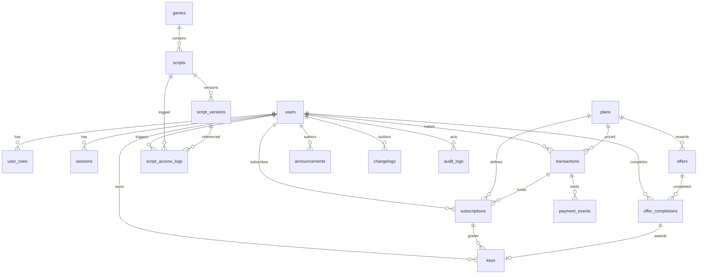
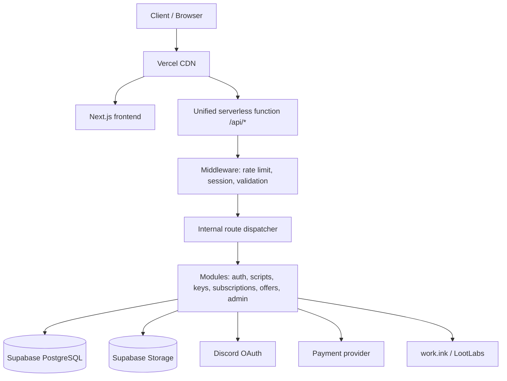
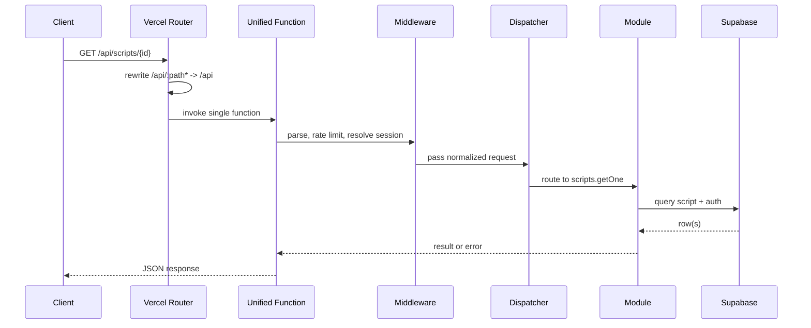
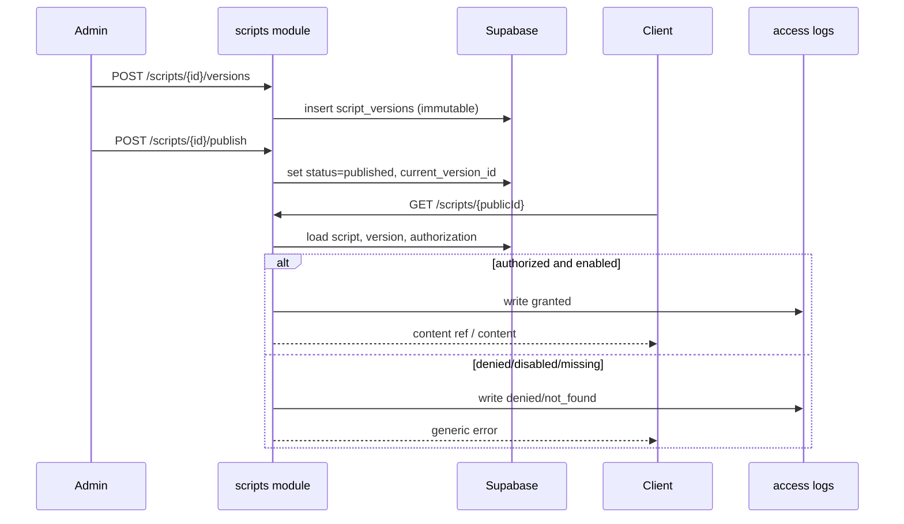
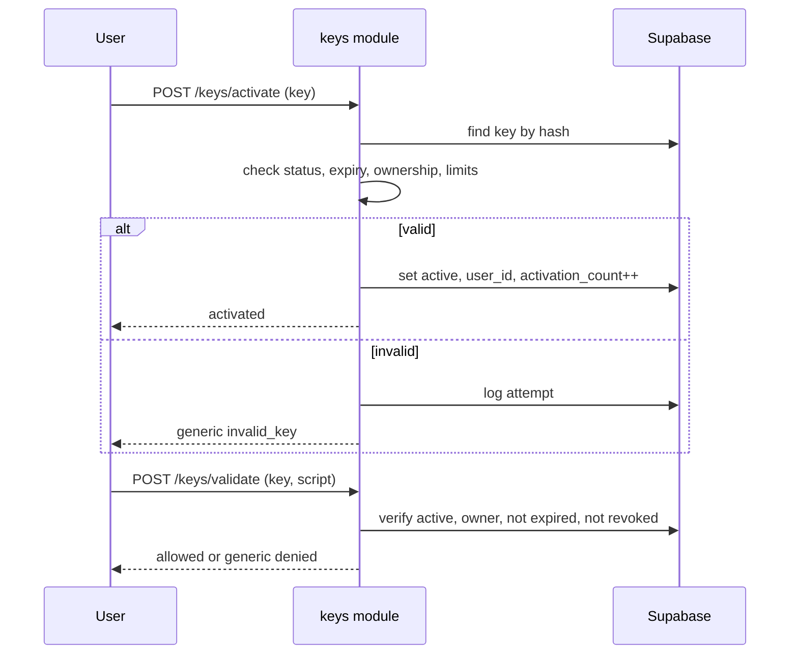
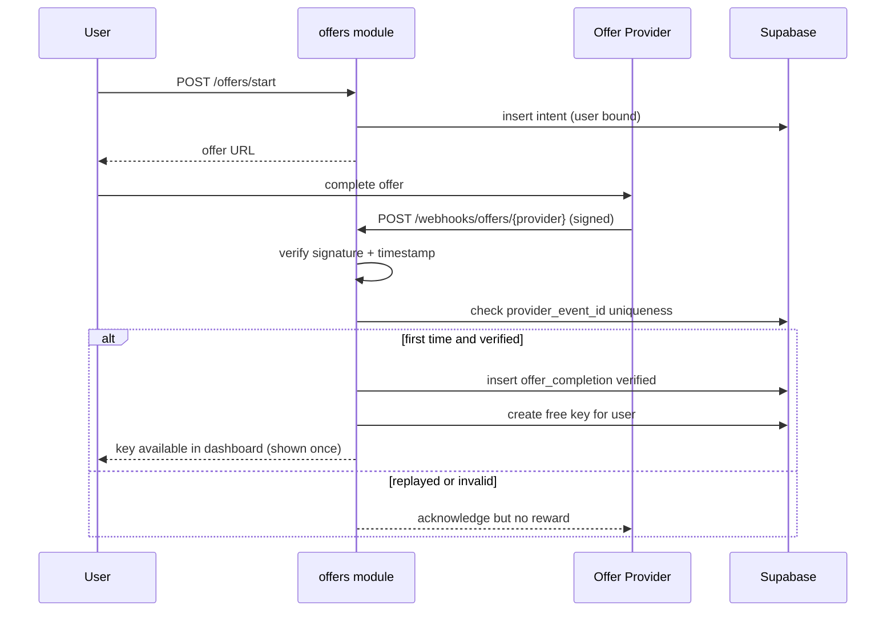

# BOYFINITY Hub - Backend Architecture

**Version:** 1.1
**Status:** Architecture Blueprint (planning only, no implementation)
**Runtime target:** Vercel Hobby, Unified Monolithic Serverless Engine
**Data layer:** Supabase PostgreSQL

This document is the implementation blueprint for the BOYFINITY Hub backend. It is a plan, not code. It defines the stack, the routing model, the data model, the API surface, security controls, and a phased roadmap.

Related documents:

- `DESIGN.md` - visual specification (frontend).
- `AGENTS.md` - agent routing rules.

---

## 1. Scope and Non-Goals

### In scope

- Centralized script catalog and authorized distribution API.
- Discord OAuth 2.0 authentication.
- Free and paid key lifecycle.
- Subscription and transaction management.
- Offer (work.ink / LootLabs) completion verification.
- User and admin dashboards (backend contracts).
- Audit logging and security controls.
- Vercel deployment topology and Supabase data model.

### Out of scope (explicit non-goals)

- No executor injection, anti-cheat bypass, or unauthorized game exploitation. The script API only serves games and experiences the project owner is permitted to manage.
- No frontend implementation in this task.
- No real credentials, tokens, or secrets are defined here.
- No changes to existing project files other than this document.

### Confirmed product constraints

- Public pages are browsable without authentication.
- Discord authentication is required to claim free keys, purchase keys, access dashboards, and perform account operations.
- Administrative operations require server-side admin authorization.
- Deployment target is Vercel Hobby with Supabase as the database.

---

## 2. Technology Stack

Each technology is assessed below for purpose, advantages, limitations, and alternatives. No additional infrastructure is introduced without a stated technical justification.

### 2.1 Frontend - Next.js

- **Purpose:** Public landing page, documentation, user dashboard, admin dashboard, marketplace UI.
- **Advantages:** File-based routing, server components, built-in Route Handlers, static generation for public pages, first-class Vercel integration, strong ecosystem.
- **Limitations:** Next.js generates its own build output and Vercel Functions per route. This directly affects the unified-function requirement (see Section 4). It is opinionated about where API code lives.
- **Alternatives:** Remix / React Router (SSR-friendly), Astro (content-heavy public pages), plain React SPA (loses SSR). Next.js is the recommended choice for consistency with the preferred stack and Vercel.

### 2.2 Hosting - Vercel

- **Purpose:** Static hosting, CDN, serverless compute, preview deployments, edge routing.
- **Advantages:** Zero-ops, global CDN, preview deployments per commit, tight Git workflow, generous Hobby allotment.
- **Limitations (Hobby):** See Section 4.8. Key ones: 4.5 MB request/response body limit, 300s max function duration, 2 GB / 1 vCPU per function instance, runtime logs retained only 1 hour, no git-org repositories on Hobby.
- **Alternatives:** Netlify, Cloudflare Workers/Pages (different runtime model), self-hosted VPS (more control, more ops). Vercel is recommended.

### 2.3 Backend API - Node.js Serverless Functions

- **Purpose:** All API logic: auth, scripts, keys, subscriptions, offers, admin.
- **Advantages:** Full Node.js API coverage, large ecosystem, easy Supabase SDK use, streaming support, Fluid compute concurrency reuse.
- **Limitations:** Cold starts (mitigated by Fluid compute instance reuse), statelessness (no in-memory session), 4.5 MB payload cap.
- **Alternatives:** Edge runtime (fast but limited Node APIs, not ideal for DB drivers), a long-lived Node server on a VPS (defeats the unified serverless goal). Node.js runtime on Vercel is recommended.

### 2.4 Database - Supabase PostgreSQL

- **Purpose:** Relational storage for users, scripts, keys, subscriptions, transactions, offers, audit logs.
- **Advantages:** Managed PostgreSQL, Row Level Security, Auth (Discord provider available), Storage, Realtime, auto-generated REST/GraphQL, connection pooler (Supavisor).
- **Limitations:** Direct connections are limited; serverless requires a pooler. RLS is only meaningful when the client role is untrusted; server code using the service role bypasses RLS by design.
- **Alternatives:** Neon (serverless Postgres, branch-based), PlanetScale (MySQL, no FKs), Turso (SQLite/libSQL). Supabase is recommended because it bundles Postgres, RLS, Storage, and Auth in one platform.

### 2.5 Authentication - Discord OAuth 2.0

- **Purpose:** Identify users by immutable Discord user ID.
- **Advantages:** No password storage, strong trusted identity, matches the target audience.
- **Limitations:** External dependency on Discord uptime and rate limits; OAuth flows must be handled server-side for state validation and token exchange.
- **Alternatives:** Supabase Auth with the Discord provider (wraps the same OAuth flow and manages sessions), GitHub OAuth (less aligned with the audience). See Section 5 for the recommended hybrid.

### 2.6 Storage - Supabase Storage

- **Purpose:** Script content blobs, game imagery, avatar cache, downloadable assets.
- **Advantages:** S3-compatible API, integrated auth policies, CDN-backed delivery, RLS-aware.
- **Limitations:** Object storage is not ideal for small frequently-read JSON; keep metadata in Postgres and store only large blobs here.
- **Alternatives:** Cloudflare R2 (cheap egress), Vercel Blob, AWS S3. Supabase Storage is recommended for single-platform simplicity.

### 2.7 Styling - Tailwind CSS

- **Purpose:** Frontend styling tokens aligned with `DESIGN.md`.
- **Advantages:** Utility-first, token-friendly via config, pairs with Next.js.
- **Limitations:** Purely frontend; no backend impact. Listed for stack completeness.
- **Alternatives:** CSS Modules, vanilla-extract. Frontend concern; not elaborated here.

---

## 3. Unified Monolithic Serverless Engine - Design

### 3.1 Architecture requirement

All `/api/*` traffic should reach a single Vercel Serverless Function wherever technically supported, with internal route dispatching. Logical endpoint groups:

- `/api/auth/*`
- `/api/users/*`
- `/api/scripts/*`
- `/api/games/*`
- `/api/keys/*`
- `/api/subscriptions/*`
- `/api/transactions/*`
- `/api/offers/*`
- `/api/admin/*`

A single entry point does **not** mean one giant file. Internal modules stay separated:

```text
BOYFINITY-Hub/
├── api/
│   └── index.js
├── src/
│   ├── modules/
│   │   ├── auth/
│   │   ├── users/
│   │   ├── scripts/
│   │   ├── games/
│   │   ├── keys/
│   │   ├── subscriptions/
│   │   ├── transactions/
│   │   ├── offers/
│   │   └── admin/
│   ├── middleware/
│   ├── services/
│   ├── database/
│   ├── validators/
│   └── utils/
├── public/
├── DESIGN.md
├── AGENTS.md
├── BACKEND.md
└── vercel.json
```

This tree is a target, not a build instruction. No files are created in this task.

### 3.2 Feasibility findings (verified against Vercel conventions)

The following are verified facts, not assumptions.

1. **Can `api/index.js` serve all `/api/*` requests as one function?**
   Yes, but **not automatically for nested paths**. Vercel creates a separate function per source file in the root `api/` directory, and a file at `api/index.js` maps to the `/api` path only. Nested paths such as `/api/auth/login` will not reach it unless rewrites are configured. Vercel's own Node.js runtime documentation recommends exactly this pattern: "Keep related routes in a shared function", define a single fetch handler that "receives requests for all HTTP methods and routes them by URL pathname", and "configure rewrites to send related API paths to the same function".

2. **Correct routing configuration.**
   Add a rewrite that funnels every `/api/*` path into the single entry point. A minimal `vercel.json`:

   ```json
   {
     "$schema": "https://openapi.vercel.sh/vercel.json",
     "rewrites": [
       { "source": "/api/:path*", "destination": "/api" }
     ]
   }
   ```

   The original path must be preserved because the rewrite target is the function itself. Two reliable options:
   - Read the original path from the forwarded request URL or a request header inside the handler.
   - Prefer the explicit form where the handler reconstructs the path from `req.url` / the `x-forwarded-*` headers, and always log it for observability.

   Because a rewrite masks the destination, the handler must not rely on its own URL alone; it should parse the incoming request path. The safest, most portable approach is to dispatch on the request pathname derived from the incoming request, and to keep the rewrite rule as the single funnel.

3. **Do Next.js routing conventions conflict?**
   Yes. This is the single most important routing finding.
   - When a project is detected as **Next.js**, Vercel builds it as a Next.js app. Next.js owns `/api/*` through **Route Handlers** (`app/api/**/route.ts`), and each route handler becomes a Vercel Function unless bundled.
   - A root `api/` directory with hand-written functions is the **non-Next.js convention**. Mixing a root `api/index.js` with a Next.js app is fragile: it can be ignored, double-built, or shadowed by Next.js routing, and it is not the documented pattern.
   - Therefore, for this project, the **reliable unified path depends on whether the deployment is a Next.js app or a plain Node project** (see 3.4).

4. **How should internal dispatch work?**
   The entry point is a thin router. It:
   - Parses method and pathname.
   - Strips the `/api` prefix to get a logical route segment.
   - Matches against a route table whose entries map to module handlers.
   - Runs the middleware chain (auth, rate limit, validation) before the module handler.
   - Returns a normalized response.

   Dispatch is data-driven, not a chain of `if (url === ...)` statements. Example shape (illustrative only, not implemented):

   ```js
   const routes = [
     { method: 'POST', path: '/auth/login',      handler: auth.login,      access: 'public' },
     { method: 'GET',  path: '/scripts/:id',     handler: scripts.getOne,  access: 'public' },
     { method: 'POST', path: '/keys/claim',      handler: keys.claim,      access: 'user' },
     { method: 'POST', path: '/admin/scripts',   handler: admin.createScript, access: 'admin' },
   ];
   ```

5. **How to avoid accidentally generating additional functions.**
   - Keep every module and utility **outside** any recognized function directory (`api/` for the plain Node case, `app/api/` for Next.js). Only the single entry point lives in a function-triggering location.
   - In the plain Node case: exactly one file in `api/`. Every other module is imported from `src/`.
   - In the Next.js case: exactly one catch-all route handler file (`app/api/[...path]/route.ts`) and no other `route.ts` under `app/api/`.
   - Do not add files that Vercel classifies as functions (files directly in `api/`, or `route.ts` files).
   - Verify after deploy by checking the build output's function list.

6. **How modular code is imported into the unified function.**
   The entry point statically imports the module registry: `import { routes } from '../src/router'`, which imports modules, which import services and the database layer. Static imports are required for bundling; dynamic imports with runtime-computed paths can cause the bundler to include whole directories and bloat the bundle (see the 250 MB limit).

7. **Hobby function-count limitation and practical implications.**
   The old hard "12 functions" limit is **no longer listed** for current accounts; the current limits table lists "Functions Created per Deployment" as **framework-dependent** for Hobby and unlimited for Pro. Practical implications:
   - The constraint is no longer a hard function cap on Hobby, but keeping one function is still valuable: Fluid compute **reuses instances across routes within one function**, reducing cold starts and cost.
   - The real Hobby constraints are payload, duration, memory, and log retention (below), not function count.
   - Historical tutorials referencing "12 functions" are outdated; do not design around that number.

8. **Runtime, memory, duration, payload, cold-start limits (Hobby, current).**

   | Limit | Hobby value |
   |---|---|
   | Max memory / CPU | 2 GB / 1 vCPU (default and max) |
   | Max duration | 300s (5 min) default and max |
   | Request/response body | 4.5 MB (413 `FUNCTION_PAYLOAD_TOO_LARGE` beyond) |
   | Bundle size (uncompressed) | 250 MB |
   | File descriptors | 1,024 shared across concurrent executions |
   | Runtime log retention | 1 hour |
   | Regions | Single region (default `iad1`) |
   | Concurrent deployments | 1 |

   Cold starts are mitigated by Fluid compute (concurrent requests reuse a warm instance). Keep the bundle lean and initialize the DB client lazily.

9. **Database connection management with Supabase.**
   - Serverless functions are stateless and scale horizontally; a direct Postgres connection per invocation exhausts connections.
   - Use Supabase's **connection pooler** (Supavisor, transaction mode) via a pooled connection string for server-side queries.
   - Use the **service role key only on the server**, never in the browser. It bypasses RLS, so treat it as a root credential.
   - Initialize one client per function instance (module-scope singleton), not per request.
   - For the Next.js case, prefer the official Supabase SSR helpers and keep the service-role usage confined to server-only modules.

10. **Appropriateness for future growth.**
    Yes. A single function with a data-driven router scales to a large API surface. The real growth risks are bundle size and single-region latency, both addressable (see Section 4.11 migration strategy). The modular structure means splitting later is mechanical.

11. **Migration strategy to multiple functions.**
    - Because modules are independent and the router is data-driven, moving a group (e.g. `/admin/*`) to its own function is a routing change, not a rewrite.
    - Steps: create a new function file, point the relevant rewrite source at it, remove that prefix from the unified router, verify, deploy.
    - Trigger conditions for splitting: bundle size approaching 250 MB, a group needing a longer duration, or a group with very different traffic/scaling needs.
    - Keep the split behind the same public URLs so clients are unaffected.

### 3.3 Recommended routing design

The unified entry point is viable. The recommended, reliable configuration is a **single catch-all router** with **one rewrite rule**, and the entry point dispatches on pathname.

```json
{
  "$schema": "https://openapi.vercel.sh/vercel.json",
  "rewrites": [
    { "source": "/api/:path*", "destination": "/api" }
  ]
}
```

Key rules:

- The rewrite is the only place that knows about the funnel. Module code never re-implements URL routing.
- The handler derives the logical path from the incoming request (pathname minus `/api`).
- Every module is imported from `src/`, never placed in a function directory.
- All responses go through one response helper for consistent error shape and headers.

### 3.4 Deployment-model decision (required trade-off)

The unified function cannot be described without choosing the deployment model, because Next.js and a root `api/` folder do not mix cleanly. Two valid models exist.

**Model A - Next.js app with one catch-all Route Handler (recommended if the frontend is Next.js).**

- Frontend and backend live in one Next.js project.
- The single backend function is `app/api/[...path]/route.ts`.
- It owns all `/api/*` and delegates to `src/` modules.
- No root `api/` directory is used. No `vercel.json` rewrite is needed for internal API routing, because the catch-all route already matches every `/api/*` path.
- Trade-off: the "entry point" is a Next.js Route Handler, not a literal `api/index.js`. This is the idiomatic, supported way to achieve the same goal inside Next.js. It is the most reliable option when the frontend is Next.js.

**Model B - Plain Node project with `api/index.js` (recommended if the frontend is separate or minimal).**

- The backend is a standalone Node project (or a separate deployment) whose only function is `api/index.js`.
- `vercel.json` rewrites funnel `/api/*` into it.
- Trade-off: the frontend is not a Next.js app in this deployment, or lives in a separate project/domain. This matches the literal `api/index.js` requirement.

**Recommendation:** Use **Model B** if the requirement to have a literal `api/index.js` and one function must be met exactly, because it is the only model where `api/index.js` is genuinely the single function. Use **Model A** if a single Next.js project hosting both frontend and backend is preferred; it achieves the same single-function outcome but the entry point is a Route Handler. Do not attempt to combine a root `api/index.js` with a Next.js app; that is the fragile configuration identified in 3.2 item 3.

If the project must be one Next.js app **and** a literal `api/index.js` is non-negotiable, the honest answer is that these two goals conflict, and the requirement should be resolved with the owner (see Section 16).

### 3.5 Avoiding accidental extra functions (checklist)

- [ ] Exactly one function-triggering file exists (plain: `api/index.js`; Next.js: one catch-all `route.ts`).
- [ ] No other files in `api/` (plain model).
- [ ] No other `route.ts` under `app/api/` (Next.js model).
- [ ] All modules, services, validators, and DB code live under `src/`.
- [ ] Imports are static, not dynamically computed paths.
- [ ] Post-build: verify the function list contains exactly the intended function(s).

---

## 4. Discord Authentication

### 4.1 Principles

- Identify users by the **immutable Discord user ID** (the snowflake), never by username or discriminator, which can change.
- **Never request or store Discord passwords.** OAuth only.
- Validate OAuth **state** on every callback.
- Use **HTTP-only, Secure, SameSite** session cookies.
- Session expiration and renewal are server-controlled.
- Roles are verified **server-side** on every privileged request.
- Never trust a client-supplied role, user ID, or session flag.

### 4.2 Authentication flow

1. **Initiate:** `GET /api/auth/login` generates a random, cryptographically strong `state`, stores it in a short-lived HTTP-only cookie (or a `sessions`/`oauth_states` row), then redirects to Discord's authorize URL with the client ID, redirect URI, scopes (`identify`), and `state`.
2. **Consent:** The user authorizes on Discord.
3. **Callback:** `GET /api/auth/callback?code=...&state=...`. The server:
   - Rejects if `state` is missing or does not match the stored value.
   - Exchanges `code` for an access token at Discord's token endpoint, server-side, using the client secret.
   - Fetches the user profile (`/users/@me`) with the access token.
   - Upserts the user by `discord_id`.
   - Creates a session, sets the session cookie, and redirects to the app.
4. **Session:** A session record (or signed token) is stored server-side (see Section 9, `sessions`). The cookie carries only an opaque session identifier.
5. **Logout / revoke:** `POST /api/auth/logout` deletes the session and clears the cookie. `POST /api/auth/logout-all` revokes every session for the user.

### 4.3 Session strategy

- Cookie: HTTP-only, `Secure`, `SameSite=Lax` (or `Strict` if feasible), scoped to the site, with a bounded `Max-Age`.
- Store a **hashed** session token server-side with expiry and rotation metadata.
- **Expiration:** absolute lifetime (e.g. 7–30 days) plus idle timeout.
- **Renewal:** rotate the session token on privilege change and after a fixed interval (sliding window) to limit theft impact.
- **Revocation:** deleting the `sessions` row invalidates the cookie immediately (no client cooperation needed).

### 4.4 Both integration options with Supabase

Two valid approaches:

- **Option 1 - Supabase Auth (Discord provider).** Supabase performs the OAuth exchange and issues its own session; the app verifies the Supabase JWT server-side. Less custom code, built-in refresh, but the session model is Supabase's.
- **Option 2 - Custom Discord OAuth.** The app performs the OAuth exchange and owns the session table. Maximum control, more code to get right.

**Recommendation:** Option 2 (custom) if the platform requires full control over session lifetime, revocation, and audit; Option 1 if time-to-market and less security-critical surface are priorities. Either way, store the Discord user ID on `users.discord_id` and treat it as the identity anchor. Do not rely on Discord tokens as the app session.

### 4.5 Authorization and admin protection

- Roles live in `user_roles` (see Section 9). The set of roles is small and explicit (for example `user`, `moderator`, `admin`).
- Every admin endpoint runs a server-side middleware that: loads the session, loads the user, loads roles from the database, and checks the required role. Client role claims are ignored.
- Administrative endpoints are grouped under `/api/admin/*` and are **never** reachable without an authenticated session with an admin role.
- Sensitive admin actions write an `audit_logs` row (Section 12).

---

## 5. Script Management System

### 5.1 Capabilities (admin)

Create, edit, delete scripts; publish/unpublish; enable/disable; manage versions; assign scripts to games; view access logs.

### 5.2 Script record

| Field | Meaning |
|---|---|
| `id` | Internal database ID (UUID). Never exposed as the primary public handle. |
| `public_id` | Public API identifier (opaque, non-sequential). |
| `name` | Display name. |
| `description` | Human description. |
| `game_id` | Associated game (FK to `games`). |
| `current_version_id` | Points to the active published version. |
| `content_ref` | Script content or storage reference (inline text or Supabase Storage object). |
| `status` | Publication status: `draft`, `published`, `archived`. |
| `enabled` | Boolean kill switch. |
| `created_at`, `updated_at` | Timestamps. |

### 5.3 ID generation

- Internal `id`: database-generated UUID.
- `public_id`: a random, URL-safe, high-entropy string (for example 22+ chars, base62 or base64url) that is unguessable and non-sequential. This prevents enumeration. The public API uses `public_id`, never `id`.
- If a versioned handle is needed, the public identifier can encode script plus version, but the mapping is always resolved server-side.

### 5.4 Publishing and versioning

- Content changes create a new `script_versions` row rather than mutating history.
- **Publishing** sets `scripts.status = published` and `current_version_id` to the chosen version; the previously current version is retained in history.
- **Unpublishing** sets `status` back to `draft` (or `archived`); the public API stops returning the script.
- **Editing** creates a new draft version. Published versions are immutable; corrections produce a new version.
- Version history is queryable by admins; each version records `version_number`, `content_ref`, `changelog`, `created_by`, `created_at`.

### 5.5 Disabled and deleted scripts

- **Disabled** (`enabled = false`): the script still exists but the public API returns `404` (or `403`, see 5.7) and logs the attempt. This is the quick kill switch for incidents.
- **Deleted**: prefer **soft delete** (`deleted_at` timestamp) so audit history and key links survive. Hard delete is reserved for admin-only, fully audited actions. A soft-deleted script is invisible to the public API and to non-admin dashboards.

### 5.6 Retrieval and authorization

- Public endpoint: `GET /api/scripts/{publicId}` returns the currently published, enabled version. Only after the request passes authorization and logging.
- Authorization model: retrieval is gated by a **key**, an **authorized integration**, or an explicit **public/allowlisted** flag on the script.
- The response returns the content reference (or streams the content) only when authorized; unauthorized requests get a generic error, never partial content.

### 5.7 Preventing unauthorized retrieval

- Opaque `public_id`, no sequential IDs, no `id` leakage in payloads.
- One shared error shape for "not found" and "not authorized" so the API does not reveal which scripts exist.
- Rate limiting per IP and per key (Section 12).
- Every successful and failed retrieval writes a `script_access_logs` row: `script_id`, `version_id`, `actor_user_id` (nullable), `key_id` (nullable), `ip`, `user_agent`, `result`, `created_at`.
- Content served from Supabase Storage uses short-lived signed URLs, not permanent public links.

### 5.8 Authorized integrations (scope boundary)

The API supports integrations for games and experiences the project owner is **permitted to manage**. Integrations are registered server-side with their own credentials/scopes. This blueprint does not design executor injection, anti-cheat bypass, or unauthorized modification of third-party games, and no endpoint exists for those purposes.

---

## 6. Key Management

### 6.1 Capabilities

Generate keys; free and paid types; associate keys with users; activation; expiration; revocation; validation; subscription association; usage tracking; admin management.

### 6.2 Key model

| Field | Meaning |
|---|---|
| `id` | Internal UUID. |
| `key_hash` | Hash of the key value. The plaintext key is shown once at creation and never stored. |
| `key_prefix` | Short non-secret prefix for display/support. |
| `type` | `free` or `paid`. |
| `status` | `unused`, `active`, `expired`, `revoked`, `used_up`. |
| `user_id` | Owner after activation (nullable before). |
| `subscription_id` | FK when the key grants a subscription (nullable). |
| `plan_id` | Optional plan link. |
| `max_activations` | Usually 1 for a single-user key. |
| `activation_count` | Number of activations consumed. |
| `expires_at` | Expiry timestamp (nullable for perpetual, though rare). |
| `created_at`, `updated_at` | Timestamps. |

### 6.3 Generation

- Generate with a cryptographically secure RNG (not `Math.random`).
- Sufficient entropy to resist brute force (for example 128+ bits), formatted in readable groups for the user.
- Store only the **hash** (`key_hash`) plus a display `key_prefix`. The plaintext is returned exactly once in the creation response.
- Guard against duplicate hashes with a unique constraint on `key_hash`.

### 6.4 Lifecycle

1. **Generate** (admin or system): key created with `status = unused`.
2. **Distribute**: free keys via offer completion; paid keys via transaction completion.
3. **Activate**: a user binds an `unused` key to their account (`status = active`, `user_id` set, `activation_count++`). Rejected if the key is expired or revoked or already bound.
4. **Use**: each script fetch is validated against the key's status, owner, and expiry. Every use increments usage tracking.
5. **Expire**: reached `expires_at`, or subscription end; `status = expired`.
6. **Revoke**: admin action; `status = revoked`. Effective immediately.
7. **Renew**: for subscription keys, renewal extends `expires_at` and links a new subscription period rather than mutating history.

### 6.5 Validation rules

A key request is valid only if all hold:

- The key hash matches a stored key.
- `status` is `active` (or `unused` during activation).
- Not past `expires_at`.
- Not revoked.
- The requesting user owns the key (or the key is unbound during activation).
- `activation_count < max_activations` where applicable.

Failure returns a generic error; the specific reason is logged, not disclosed to the client (prevents oracle attacks).

### 6.6 Prevention requirements (mapped to controls)

| Threat | Control |
|---|---|
| Unauthorized key reuse | Bind to `user_id` on activation; one activation unless explicitly multi-use; server-side checks. |
| Invalid key activation | Validate type, status, and expiry before binding. |
| Expired key access | Server-side expiry check on every request. |
| Revoked key access | Status check on every request; revocation is immediate. |
| Client-side authorization bypass | All validation on the server; the client only presents a key, never a verdict. |
| Brute force | Rate limiting on activation attempts plus high key entropy. |
| Replay of a key in another account | Ownership binding plus server session check. |

---

## 7. Monetization and Offers

### 7.1 Capabilities

Free key claiming; work.ink and LootLabs offer integration; monthly, 3-month, and 6-month subscriptions; transaction history; payment verification; subscription expiration and renewal.

### 7.2 Subscriptions

- Plans are rows in `plans` (see Section 9) with duration and price metadata. Durations: monthly, 3-month, 6-month.
- A subscription is a row in `subscriptions` linking `user_id`, `plan_id`, `status`, `started_at`, `expires_at`, and the originating `transaction_id`.
- **Expiration:** reached `expires_at`; a scheduled job or lazy check flips status to `expired`.
- **Renewal:** a new payment creates a new subscription period; the previous period is preserved. Stacking extends `expires_at`.

### 7.3 Free key claiming

1. User is authenticated.
2. User starts an offer; the platform returns an offer URL from work.ink or LootLabs.
3. User completes the offer on the provider.
4. Provider sends a **server-to-server callback** to our endpoint.
5. The server verifies the callback (see 7.4), records an `offer_completions` row, and issues a free key to the user.
6. The key is returned to the user (shown once) and logged.

**The browser redirect back to our site is never proof of completion.** Only the verified server callback releases a key.

### 7.4 Offer callback verification

- Verify the provider's signature or shared-secret hash on the raw request body.
- Check the callback timestamp against a tolerance window to reject stale requests.
- Enforce **idempotency** with a unique constraint on `(provider, provider_event_id)` so a replayed callback cannot issue a second key.
- Confirm the claimed offer matches the user and the expected reward before issuing anything.
- Reject any callback whose signature cannot be verified; log the attempt.
- Do not trust any parameter that the client could set (user id in the URL, redirect query, etc.). The user identity must come from the signed callback payload or from a stored, pre-created offer session tied to that user.
- Since a callback arrives before or without a browser session, bind the offer to the user at **offer start** (store an `offers`/`offer_completions` intent row keyed by a signed token), then match it on callback.

### 7.5 Payments

- **Never rely exclusively on client-side payment status.** A client saying "paid" is not proof.
- Provider-independent architecture: an abstract `PaymentVerifier` interface with one implementation per provider. The rest of the system depends only on the interface.
- Provider secrets stay **server-side** in environment variables (Section 13). Never sent to the browser.
- Payment confirmation arrives as a signed server callback (webhook). The server verifies the signature, records a `payment_events` row, and only then marks the transaction `paid` and grants the key/subscription.
- Reconciliation: a periodic job can query the provider's API for pending transactions as a backstop, so a missed webhook does not lose a payment.
- **Do not invent credentials.** No provider is assumed configured; the architecture defines the contract, and the owner supplies real keys at deployment time.

---

## 8. Database Architecture

### 8.1 Conventions

- PostgreSQL (Supabase). UUID primary keys (`gen_random_uuid()`), `timestamptz` timestamps defaulting to `now()`.
- `snake_case` names. Soft delete via `deleted_at` where history matters.
- Money stored as integer minor units (for example cents) plus a currency code, never as floating point.
- All tables have `created_at`; mutable tables also have `updated_at`.

### 8.2 Tables

**users**

| Column | Type | Notes |
|---|---|---|
| id | uuid | PK |
| discord_id | text | Unique, not null (identity anchor) |
| username | text | Display only, mutable |
| avatar_url | text | Nullable |
| email | text | Nullable, only if scope granted |
| status | text | `active`, `suspended`, `deleted` |
| created_at / updated_at | timestamptz | |

- Unique: `discord_id`. Index: `status`.

**user_roles**

| Column | Type | Notes |
|---|---|---|
| id | uuid | PK |
| user_id | uuid | FK users(id), on delete cascade |
| role | text | `user`, `moderator`, `admin` |
| granted_by | uuid | Nullable FK users(id) |
| created_at | timestamptz | |

- Unique: `(user_id, role)`. Index: `user_id`.

**games**

| Column | Type | Notes |
|---|---|---|
| id | uuid | PK |
| name | text | Not null |
| slug | text | Unique |
| description | text | Nullable |
| image_url | text | Nullable |
| created_at / updated_at | timestamptz | |

- Unique: `slug`.

**scripts**

| Column | Type | Notes |
|---|---|---|
| id | uuid | PK |
| public_id | text | Unique, opaque |
| name | text | Not null |
| description | text | Nullable |
| game_id | uuid | FK games(id) |
| current_version_id | uuid | FK script_versions(id), nullable |
| content_ref | text | Inline or storage reference |
| status | text | `draft`, `published`, `archived` |
| enabled | boolean | Default true |
| created_by | uuid | FK users(id) |
| deleted_at | timestamptz | Nullable (soft delete) |
| created_at / updated_at | timestamptz | |

- Unique: `public_id`. Indexes: `game_id`, `status`, `enabled`.

**script_versions**

| Column | Type | Notes |
|---|---|---|
| id | uuid | PK |
| script_id | uuid | FK scripts(id), on delete cascade |
| version_number | integer | Monotonic per script |
| content_ref | text | Immutable content |
| changelog | text | Nullable |
| created_by | uuid | FK users(id) |
| created_at | timestamptz | |

- Unique: `(script_id, version_number)`.

**script_access_logs**

| Column | Type | Notes |
|---|---|---|
| id | uuid | PK |
| script_id | uuid | FK scripts(id) |
| version_id | uuid | Nullable FK script_versions(id) |
| actor_user_id | uuid | Nullable FK users(id) |
| key_id | uuid | Nullable FK keys(id) |
| ip | text | Nullable |
| user_agent | text | Nullable |
| result | text | `granted`, `denied`, `not_found` |
| created_at | timestamptz | |

- Indexes: `script_id`, `created_at` (partition/retention candidate).

**plans**

| Column | Type | Notes |
|---|---|---|
| id | uuid | PK |
| code | text | Unique (`monthly`, `3month`, `6month`) |
| name | text | Not null |
| duration_days | integer | Not null |
| price_minor | integer | Minor units |
| currency | text | ISO code |
| active | boolean | Default true |
| created_at / updated_at | timestamptz | |

- Unique: `code`.

**keys**

| Column | Type | Notes |
|---|---|---|
| id | uuid | PK |
| key_hash | text | Unique, not null |
| key_prefix | text | Display only |
| type | text | `free`, `paid` |
| status | text | `unused`, `active`, `expired`, `revoked`, `used_up` |
| user_id | uuid | Nullable FK users(id) |
| subscription_id | uuid | Nullable FK subscriptions(id) |
| plan_id | uuid | Nullable FK plans(id) |
| max_activations | integer | Default 1 |
| activation_count | integer | Default 0 |
| expires_at | timestamptz | Nullable |
| created_at / updated_at | timestamptz | |

- Unique: `key_hash`. Indexes: `user_id`, `status`.

**subscriptions**

| Column | Type | Notes |
|---|---|---|
| id | uuid | PK |
| user_id | uuid | FK users(id) |
| plan_id | uuid | FK plans(id) |
| transaction_id | uuid | Nullable FK transactions(id) |
| status | text | `pending`, `active`, `expired`, `cancelled` |
| started_at | timestamptz | Nullable |
| expires_at | timestamptz | Nullable |
| created_at / updated_at | timestamptz | |

- Indexes: `user_id`, `status`, `expires_at`.

**transactions**

| Column | Type | Notes |
|---|---|---|
| id | uuid | PK |
| user_id | uuid | FK users(id) |
| plan_id | uuid | Nullable FK plans(id) |
| provider | text | Payment provider id |
| provider_txn_id | text | Unique per provider when present |
| amount_minor | integer | Minor units |
| currency | text | ISO code |
| status | text | `pending`, `paid`, `failed`, `refunded` |
| created_at / updated_at | timestamptz | |

- Unique: `(provider, provider_txn_id)`. Index: `user_id`, `status`.

**payment_events**

| Column | Type | Notes |
|---|---|---|
| id | uuid | PK |
| provider | text | Provider id |
| provider_event_id | text | Provider event id |
| transaction_id | uuid | Nullable FK transactions(id) |
| raw_payload | jsonb | Stored for audit |
| signature_valid | boolean | Verification result |
| processed_at | timestamptz | Nullable |
| created_at | timestamptz | |

- Unique: `(provider, provider_event_id)` (idempotency).

**offers**

| Column | Type | Notes |
|---|---|---|
| id | uuid | PK |
| provider | text | `workink`, `lootlabs` |
| code | text | Internal offer code |
| reward_plan_id | uuid | Nullable FK plans(id) |
| reward_key_type | text | e.g. `free` |
| active | boolean | Default true |
| created_at / updated_at | timestamptz | |

- Unique: `(provider, code)`.

**offer_completions**

| Column | Type | Notes |
|---|---|---|
| id | uuid | PK |
| offer_id | uuid | FK offers(id) |
| user_id | uuid | FK users(id) |
| provider_event_id | text | Provider callback id |
| status | text | `pending`, `verified`, `rejected`, `rewarded` |
| reward_key_id | uuid | Nullable FK keys(id) |
| verified_at | timestamptz | Nullable |
| created_at | timestamptz | |

- Unique: `(provider_event_id)` for replay protection. Indexes: `user_id`, `status`.

**announcements**

| Column | Type | Notes |
|---|---|---|
| id | uuid | PK |
| title | text | Not null |
| body | text | Not null |
| published | boolean | Default false |
| published_at | timestamptz | Nullable |
| created_by | uuid | FK users(id) |
| created_at / updated_at | timestamptz | |

**changelogs**

| Column | Type | Notes |
|---|---|---|
| id | uuid | PK |
| version | text | Not null |
| title | text | Not null |
| body | text | Not null |
| published | boolean | Default false |
| published_at | timestamptz | Nullable |
| created_by | uuid | FK users(id) |
| created_at / updated_at | timestamptz | |

**audit_logs**

| Column | Type | Notes |
|---|---|---|
| id | uuid | PK |
| actor_user_id | uuid | Nullable FK users(id) |
| action | text | e.g. `script.publish`, `key.revoke` |
| target_type | text | Nullable |
| target_id | text | Nullable |
| metadata | jsonb | Nullable |
| ip | text | Nullable |
| created_at | timestamptz | |

- Indexes: `actor_user_id`, `action`, `created_at`.

**sessions** (required if the custom OAuth session strategy is used)

| Column | Type | Notes |
|---|---|---|
| id | uuid | PK |
| user_id | uuid | FK users(id), on delete cascade |
| token_hash | text | Unique, not null |
| user_agent | text | Nullable |
| ip | text | Nullable |
| expires_at | timestamptz | Not null |
| revoked_at | timestamptz | Nullable |
| created_at | timestamptz | |

- Unique: `token_hash`. Index: `user_id`, `expires_at`.

### 8.3 Entity relationship diagram



### 8.4 Row Level Security strategy

- **Server-only access.** All application database access goes through the unified serverless function using the **service-role key**, which bypasses RLS. That means RLS is not the primary authorization mechanism here; application middleware is.
- **RLS as defense in depth.** Enable RLS on every table and add policies anyway, so that any accidental direct client access (for example the anon key via the Supabase client) cannot read or write data. Default deny: no policy means no access.
- **Never expose the service-role key to the browser.** Only the anon key and the public URL may be exposed, and only if a client-side Supabase client is used at all.
- If future features need direct client reads (for example public announcements), add narrow, read-only policies for those specific tables.

### 8.5 Server-side database access

- One Supabase client instance per function instance (module-scope singleton), created with the pooled connection string and the service-role key from environment variables.
- Close or reuse connections; with the Supavisor transaction pooler, connections are managed for you, but still avoid per-request client creation.
- Wrap queries in small repository functions in `src/database/` so modules never write raw SQL inline.

### 8.6 Service-role key protection

- Stored only in Vercel environment variables (server scope), never in client bundles, never in the repo.
- Never logged. If logging request context, redact `Authorization` headers and any secret fields.
- Rotation: if leaked, rotate immediately in Supabase and redeploy.

### 8.7 Migration strategy

- Use Supabase SQL migrations (or a migration tool) checked into the repo, applied in order, never hand-edited in production.
- Every migration is additive where possible; destructive changes are separate, reviewed steps.
- Keep a `schema_migrations` ledger tracking applied versions.

### 8.8 Backup and recovery

- Rely on Supabase automated backups for the base layer; confirm the plan's retention window.
- Export logical dumps on a schedule for an independent copy.
- Test restores periodically; an untested backup is not a backup.
- Store secrets and schema separately so a DB restore does not require secrets to be recreated.

---

## 9. API Specification

All routes are served by the unified engine and dispatched internally. Access levels: **public** (no auth), **user** (authenticated), **admin** (authenticated admin role).

Conventions:

- Request and response bodies are JSON unless noted.
- Errors use one shape: `{ "error": { "code": "...", "message": "..." } }` with a stable `code`.
- List endpoints support `limit`/`offset` with sane caps.
- IDs in URLs are `public_id` values for public endpoints; internal UUIDs are used only inside admin endpoints.

### 9.1 Authentication

| Method | URL | Purpose | Access |
|---|---|---|---|
| GET | `/api/auth/login` | Start Discord OAuth, set state cookie, redirect | public |
| GET | `/api/auth/callback` | Handle OAuth callback, verify state, create session | public |
| GET | `/api/auth/session` | Return current session/user summary | user |
| POST | `/api/auth/logout` | End current session | user |
| POST | `/api/auth/logout-all` | Revoke all sessions | user |

- **Validation:** callback requires `code` and matching `state`.
- **Errors:** `invalid_state`, `oauth_failed`, `session_expired`.

### 9.2 Users

| Method | URL | Purpose | Access |
|---|---|---|---|
| GET | `/api/users/me` | Current profile | user |
| PATCH | `/api/users/me` | Update display fields | user |
| GET | `/api/users/me/keys` | List own keys | user |
| GET | `/api/users/me/subscriptions` | List own subscriptions | user |
| DELETE | `/api/users/me` | Request account deletion (soft) | user |

- **Validation:** only profile display fields are user-writable; `discord_id` and roles are not.
- Public user lookups are not exposed (no enumeration).

### 9.3 Scripts

| Method | URL | Purpose | Access |
|---|---|---|---|
| GET | `/api/scripts` | List published scripts (paged, filterable by game) | public |
| GET | `/api/scripts/{publicId}` | Retrieve published, authorized version | public (auth/key-gated) |
| GET | `/api/scripts/{publicId}/versions` | Version history | admin |
| POST | `/api/scripts` | Create | admin |
| PATCH | `/api/scripts/{publicId}` | Edit metadata | admin |
| DELETE | `/api/scripts/{publicId}` | Soft delete | admin |
| POST | `/api/scripts/{publicId}/publish` | Publish current draft | admin |
| POST | `/api/scripts/{publicId}/unpublish` | Unpublish | admin |
| POST | `/api/scripts/{publicId}/enable` | Enable | admin |
| POST | `/api/scripts/{publicId}/disable` | Disable | admin |
| POST | `/api/scripts/{publicId}/versions` | Create new version | admin |
| GET | `/api/scripts/{publicId}/logs` | Access logs | admin |

- **Validation:** `game_id` must exist; content non-empty on publish; version numbers monotonic.
- **Errors:** `not_found`, `not_authorized`, `validation_error`.

### 9.4 Games

| Method | URL | Purpose | Access |
|---|---|---|---|
| GET | `/api/games` | List games | public |
| GET | `/api/games/{slug}` | Game detail | public |
| POST | `/api/games` | Create | admin |
| PATCH | `/api/games/{slug}` | Edit | admin |
| DELETE | `/api/games/{slug}` | Delete/soft delete | admin |

- **Validation:** `slug` unique, URL-safe.

### 9.5 Keys

| Method | URL | Purpose | Access |
|---|---|---|---|
| POST | `/api/keys/claim` | Claim a free key (post-offer or eligible) | user |
| POST | `/api/keys/activate` | Activate a key to the account | user |
| POST | `/api/keys/validate` | Validate a key for script access | public (key presented) |
| GET | `/api/keys/{id}/usage` | Usage tracking | user (own) |
| POST | `/api/admin/keys` | Generate keys (bulk) | admin |
| POST | `/api/admin/keys/{id}/revoke` | Revoke | admin |
| GET | `/api/admin/keys` | List/filter keys | admin |

- **Validation:** key format, ownership, status, expiry, activation limits.
- **Errors:** `invalid_key`, `expired_key`, `revoked_key`, `already_activated`, `activation_limit_reached`. All return an identical external shape to avoid oracles.

### 9.6 Subscriptions

| Method | URL | Purpose | Access |
|---|---|---|---|
| GET | `/api/subscriptions/plans` | List active plans | public |
| GET | `/api/subscriptions/me` | Current user subscriptions | user |
| POST | `/api/subscriptions/checkout` | Create checkout intent/pending transaction | user |
| POST | `/api/subscriptions/renew` | Start renewal | user |
| GET | `/api/admin/subscriptions` | List/filter all | admin |
| PATCH | `/api/admin/subscriptions/{id}` | Adjust status (audited) | admin |

- **Validation:** plan must be `active`; no client-supplied price or amount is trusted.

### 9.7 Transactions

| Method | URL | Purpose | Access |
|---|---|---|---|
| GET | `/api/transactions/me` | Own transaction history | user |
| GET | `/api/transactions/{id}` | Own transaction detail | user |
| GET | `/api/admin/transactions` | List/filter all | admin |
| POST | `/api/webhooks/payments/{provider}` | Provider payment callback | provider (signed) |

- **Validation:** webhook signature verified; event deduplicated via `payment_events`.
- **Errors:** `invalid_signature`, `duplicate_event`, `unknown_transaction`.

### 9.8 Offers

| Method | URL | Purpose | Access |
|---|---|---|---|
| GET | `/api/offers` | List active offers | public |
| POST | `/api/offers/start` | Start an offer session (binds user) | user |
| POST | `/api/webhooks/offers/{provider}` | Offer completion callback | provider (signed) |
| GET | `/api/offers/me` | Own completion history | user |
| GET | `/api/admin/offers` | Manage offers | admin |

- **Validation:** offer active; callback signature valid; timestamp within tolerance; event id unique.
- **Errors:** `invalid_signature`, `stale_callback`, `duplicate_event`, `offer_inactive`.

### 9.9 Admin operations

| Method | URL | Purpose | Access |
|---|---|---|---|
| GET | `/api/admin/overview` | Aggregate statistics | admin |
| GET | `/api/admin/users` | List/filter users | admin |
| PATCH | `/api/admin/users/{id}` | Update status/roles | admin |
| GET | `/api/admin/audit-logs` | Audit log query | admin |
| POST | `/api/admin/announcements` | Create announcement | admin |
| PATCH | `/api/admin/announcements/{id}` | Edit/publish | admin |
| POST | `/api/admin/changelogs` | Create changelog | admin |
| PATCH | `/api/admin/changelogs/{id}` | Edit/publish | admin |
| GET | `/api/admin/settings` | Read system settings | admin |
| PATCH | `/api/admin/settings` | Update system settings (audited) | admin |

- Every mutating admin route writes an `audit_logs` entry with actor, action, target, and metadata.

### 9.10 Public configuration

| Method | URL | Purpose | Access |
|---|---|---|---|
| GET | `/api/config/public` | Public, non-secret config (feature flags, plan summary, site metadata) | public |
| GET | `/api/health` | Liveness/health probe | public |

- **Validation:** `/api/config/public` must never include secrets, keys, or internal IDs.

---

## 10. Admin Dashboard Backend

### 10.1 Backend support areas

- Overview statistics (user count, active subscriptions, keys issued/activated, recent activity).
- User management (list, search, status changes, role assignment).
- Game management (CRUD).
- Script library (CRUD, versions, publish/disable).
- Key management (generate, revoke, inspect usage).
- Subscription management (list, adjust, inspect history).
- Offer management (configure providers, inspect completions).
- Transactions (list, filter, inspect payment events).
- Announcements (CRUD, publish).
- Changelog (CRUD, publish).
- Audit logs (query by actor, action, target, date).
- System settings (read/update, audited).

### 10.2 Admin permission matrix

Roles: `user`, `moderator`, `admin`. `user` is the default; only elevated roles appear below.

| Capability | moderator | admin |
|---|---|---|
| View overview statistics | yes | yes |
| View users | yes | yes |
| Change user status | no | yes |
| Assign roles | no | yes |
| Manage games | no | yes |
| Manage scripts (CRUD/version/publish) | publish/disable only | yes |
| Generate keys | limited (free) | yes |
| Revoke keys | yes | yes |
| Manage subscriptions | no | yes |
| Manage offers | no | yes |
| View transactions | read | yes |
| Manage announcements | draft only | yes |
| Manage changelog | draft only | yes |
| View audit logs | yes | yes |
| Update system settings | no | yes |

- The matrix is enforced in server-side middleware, not in the UI.
- Sensitive operations (role changes, key revocation, settings update, subscription adjustment) always write audit rows.

---

## 11. Security Architecture

### 11.1 Controls

- **Discord OAuth state validation** - random state checked on callback; reject mismatch.
- **Secure session management** - opaque token, hashed at rest, server-side expiry, rotation, immediate revocation.
- **Cookies** - HTTP-only, Secure, SameSite; no secrets in client-readable storage.
- **CSRF protection** - for state-changing requests, use SameSite cookies plus a CSRF token or a double-submit check on cookie-authenticated routes. Webhooks are exempt (they are signature-verified and not cookie-authenticated).
- **Server-side role verification** - roles loaded from the DB on each privileged request.
- **Input validation** - schema-based validation on every payload and query param.
- **SQL injection prevention** - parameterized queries via the Supabase client / query builder; never string-concatenate SQL.
- **Rate limiting** - per IP and per key on auth, key activation/validation, offer start, and webhooks. Note: serverless instances are not shared memory, so rate limiting needs a shared store (a Postgres table or an external cache) rather than in-memory counters.
- **API abuse prevention** - bounded payloads, pagination caps, timeouts, and generic errors.
- **Audit logging** - all sensitive operations recorded.
- **Secret management** - environment variables only, server scope, never logged.
- **Secure payment callbacks** - signature verification, idempotency, reconciliation.
- **Offer callback verification** - signature, timestamp tolerance, idempotency, user binding.
- **Script access authorization** - key/integration/allowlist gate before content release.
- **Safe error responses** - one shape, no stack traces, no internal IDs, no existence leaks.
- **Enumeration protection** - opaque public IDs and uniform not-found/not-authorized responses.

### 11.2 Middleware vs module responsibilities

**Middleware (runs for every request, before dispatch):**

- Request parsing and normalization.
- Method and content-type checks.
- Rate limiting.
- Session resolution (attach user if present, do not require yet).
- CORS and security headers.
- Global error handling and logging.
- Request ID assignment for tracing.

**Per-route middleware (declared on the route, runs after match):**

- Authentication requirement.
- Role/authorization requirement.
- CSRF check for cookie-authenticated state changes.
- Input validation against the route schema.

**Module-level:**

- Business rules (key lifecycle, subscription logic, script publishing rules).
- Data access via repositories.
- Audit logging for the specific action.
- Provider-specific verification (payment/offer signatures).

Rationale: cross-cutting concerns stay in middleware; policy that depends on a specific resource stays in the module so it can be tested and reasoned about locally.

---

## 12. Vercel Deployment Architecture

### 12.1 Recommended project structure

Per Section 3, one of two models:

- **Model A (Next.js):** one catch-all Route Handler at `app/api/[...path]/route.ts`; all backend logic under `src/`. No root `api/` folder.
- **Model B (plain Node):** one function at `api/index.js`; all modules under `src/`; `vercel.json` rewrites `/api/:path*` to `/api`.

### 12.2 Unified entry point configuration

- **Model A:** the catch-all route already matches every `/api/*` path; no rewrite is needed for internal API routing.
- **Model B:** add the rewrite in 12.3.

### 12.3 Routing and rewrite behavior

```json
{
  "$schema": "https://openapi.vercel.sh/vercel.json",
  "rewrites": [
    { "source": "/api/:path*", "destination": "/api" }
  ]
}
```

- A rewrite masks the destination and keeps the public URL.
- The handler must reconstruct the logical route from the incoming request path, because its own URL is the funnel target.
- Each rewrite, redirect, or header counts as a "Route"; Hobby allows 2,048 routes per deployment, which is far above what this design needs.
- In Next.js, if a rewrite is ever needed for same-app routing, put it in `beforeFiles` in `next.config.js` and exclude `/_next/` and already-prefixed paths, per Vercel's guidance.

### 12.4 Environment variables (inventory, names and purpose only)

No real values appear here. Names only.

| Name | Purpose | Scope |
|---|---|---|
| `SUPABASE_URL` | Supabase project URL | server |
| `SUPABASE_ANON_KEY` | Public anon key (only if a client Supabase client is used) | public |
| `SUPABASE_SERVICE_ROLE_KEY` | Server-only privileged DB access | server, secret |
| `SUPABASE_DB_URL` | Pooled connection string for direct DB access | server, secret |
| `DISCORD_CLIENT_ID` | Discord OAuth client id | server |
| `DISCORD_CLIENT_SECRET` | Discord OAuth client secret | server, secret |
| `DISCORD_REDIRECT_URI` | OAuth redirect target | server |
| `SESSION_SECRET` | Signing/derivation secret for sessions | server, secret |
| `SESSION_TTL_DAYS` | Session lifetime | server |
| `OFFER_WORKINK_SECRET` | work.ink callback verification secret | server, secret |
| `OFFER_LOOTLABS_SECRET` | LootLabs callback verification secret | server, secret |
| `PAYMENT_PROVIDER` | Active payment provider id | server |
| `PAYMENT_WEBHOOK_SECRET` | Payment webhook signature secret | server, secret |
| `APP_BASE_URL` | Canonical app origin for links/redirects | server |
| `RATE_LIMIT_STORE` | Identifier for the shared rate-limit store | server |
| `CRON_SECRET` | Bearer secret for scheduled jobs | server, secret |

Rules:

- Never commit secrets. Set them in Vercel project settings per environment.
- Only variables intended for the browser may be public (and in Next.js that means a `NEXT_PUBLIC_` prefix). The service-role key and all `*_SECRET` values are server-only.
- Hobby environment variable total size is capped (64 KB across names and values); keep secrets modest.

### 12.5 Production and preview deployments

- Production deploys from the main branch; preview deploys per branch/PR.
- Use separate Supabase projects (or separate schemas) for preview so test data never touches production.
- Preview deployments are protected by Vercel default auth; do not put production secrets into preview unless required.
- Set environment variables per environment (production, preview, development).

### 12.6 Supabase connection configuration

- Use the pooled connection string (Supavisor, transaction mode) for serverless queries.
- Reserve any direct connection for migrations only.
- One client per function instance; initialize lazily.

### 12.7 Logging and monitoring

- Structured JSON logs from the unified function (request id, route, status, duration).
- On Hobby, runtime logs are retained only **1 hour**; for durable audit/observability rely on the `audit_logs` and `script_access_logs` tables, not on Vercel logs.
- Use Vercel Observability for invocations, errors, and duration.
- Health probe at `/api/health` for uptime checks.

### 12.8 Deployment workflow

1. Connect the Git repo to Vercel.
2. Set environment variables per environment.
3. Push to a branch: preview deploy. Merge to main: production deploy.
4. Run migrations before or as part of deploy (a controlled step, not automatic and unreviewed).
5. Verify the function list after deploy (Section 3.5).

### 12.9 Vercel Hobby limitations (recap, applies to this design)

- Request/response body 4.5 MB; duration 300s; memory 2 GB / 1 vCPU; 250 MB bundle; 1,024 file descriptors; single region; runtime logs 1 hour; 1 concurrent deployment.
- No git-organization repositories on a Hobby team.

---

## 13. Required Diagrams

### 13.1 Overall system architecture



### 13.2 Unified serverless request lifecycle



### 13.3 Discord authentication flow

```mermaid
sequenceDiagram
  participant U as User
  participant A as /api/auth
  participant Dc as Discord
  participant DB as Supabase
  U->>A: GET /login
  A->>U: set state cookie, redirect to Discord
  U->>Dc: authorize
  Dc->>A: GET /callback?code&state
  A->>A: validate state
  A->>Dc: exchange code for token
  Dc-->>A: access token
  A->>Dc: GET /users/@me
  Dc-->>A: profile (id, username)
  A->>DB: upsert user by discord_id
  A->>DB: insert session (hashed token)
  A-->>U: set HTTP-only session cookie + redirect
```



### 13.4 Script publishing and retrieval flow



### 13.5 Key activation and validation flow



### 13.6 Free offer claiming flow



### 13.7 Database entity relationships

See Section 8.3 for the ER diagram (kept beside the schema it describes to avoid divergence).

---

## 14. Implementation Roadmap

Each phase lists dependencies, deliverables, and acceptance criteria. These phases are not executed now.

### Phase 1 - Project foundation and deployment configuration

- **Depends on:** nothing.
- **Deliverables:** repo scaffold, chosen deployment model (A or B, Section 3.4), `vercel.json`, environment variable inventory configured, `/api/health`.
- **Acceptance:** a deploy succeeds; `/api/health` returns 200; the function list shows exactly the intended function(s).

### Phase 2 - Database schema and migrations

- **Depends on:** Phase 1.
- **Deliverables:** SQL migrations for all tables in Section 8, RLS enabled with default deny, indexes and constraints.
- **Acceptance:** migrations apply cleanly to a fresh database; constraints reject invalid rows; service-role access works from the function.

### Phase 3 - Unified API engine and middleware

- **Depends on:** Phases 1–2.
- **Deliverables:** entry point with data-driven router, middleware chain (parse, rate limit, session, validation), unified error shape.
- **Acceptance:** nested routes dispatch correctly; unknown routes return a consistent 404; no extra functions are created.

### Phase 4 - Discord authentication

- **Depends on:** Phase 3.
- **Deliverables:** login/callback/session/logout, session table, role loading, admin middleware.
- **Acceptance:** full OAuth round-trip works; state mismatch is rejected; logout revokes immediately; admin routes reject non-admins.

### Phase 5 - Script and game management

- **Depends on:** Phase 4.
- **Deliverables:** games and scripts CRUD, versions, publish/unpublish/enable/disable, public retrieval with authorization and logging.
- **Acceptance:** published and enabled scripts are retrievable when authorized; disabled/deleted scripts are not; every access writes a log row; enumeration returns uniform errors.

### Phase 6 - Key management

- **Depends on:** Phase 5.
- **Deliverables:** generation, activation, validation, revocation, usage tracking, admin key management.
- **Acceptance:** lifecycle transitions are enforced; expired/revoked keys fail; client-side attempts cannot bypass server checks.

### Phase 7 - Subscription and monetization

- **Depends on:** Phase 6.
- **Deliverables:** plans, checkout intents, payment webhooks with signature verification and idempotency, subscription creation/expiry/renewal, free offer flow with signed callbacks.
- **Acceptance:** a signed webhook grants access exactly once; replays are ignored; an unsigned or stale callback grants nothing; redirects alone never grant access.

### Phase 8 - User dashboard integration

- **Depends on:** Phases 4–7.
- **Deliverables:** user-facing endpoints wired to the frontend (profile, keys, subscriptions, transactions).
- **Acceptance:** a user sees only their own data; all pages respect empty/loading/error states (frontend contract).

### Phase 9 - Admin dashboard integration

- **Depends on:** Phases 5–7.
- **Deliverables:** admin endpoints and permission matrix enforcement, audit logging on every sensitive action.
- **Acceptance:** each matrix cell behaves as specified; every sensitive action produces an audit row.

### Phase 10 - Security testing and production deployment

- **Depends on:** Phases 1–9.
- **Deliverables:** security test pass (Section 11 checklist), load check on key/public endpoints, production env configuration, backup/restore rehearsal.
- **Acceptance:** no critical findings open; production deployed; restore from backup verified.

---

## 15. Risks and Unresolved Decisions

### Confirmed requirements

- Vercel Hobby deployment; Supabase PostgreSQL; Discord OAuth; unified serverless engine; free and paid keys; subscriptions (monthly, 3-month, 6-month); work.ink and LootLabs offers; user and admin dashboards; script catalog; audit and security systems.
- Public browsing without auth; auth required for keys, purchases, dashboards.
- No executor injection, anti-cheat bypass, or unauthorized game modification.

### Recommended decisions

- Use a single catch-all function via Model A (Next.js) or Model B (plain Node), not a mix.
- Custom Discord OAuth with a server-side `sessions` table (full control), or Supabase Auth if speed is prioritized.
- Opaque `public_id` for scripts; hashed keys at rest; soft delete for scripts.
- Signature-verified, idempotent, timestamp-checked webhooks for both payments and offers.
- Shared-store rate limiting (Postgres or external cache), not in-memory.
- Supavisor pooled connections; one client per instance.

### Optional improvements

- A provider-API reconciliation job as a backstop for missed payment webhooks.
- Table partitioning or retention policy for `script_access_logs` and `audit_logs`.
- Signed short-lived URLs for all script content delivery.
- Structured tracing with request IDs surfaced in logs.

### Decisions requiring user approval

- **Deployment model A vs B** (Section 3.4). This determines whether the entry point is a Next.js Route Handler or a literal `api/index.js`. If a literal `api/index.js` is required *and* the frontend must be one Next.js app, that combination is not supported cleanly and must be resolved.
- **Session ownership:** custom OAuth vs Supabase Auth.
- **Payment provider:** none is named in the requirements; the architecture is provider-independent, but a provider must be chosen before Phase 7.
- **Free key eligibility rules:** whether free keys are strictly offer-gated, rate-limited per user, or both.
- **Multi-use / device-bound keys:** the requirement does not state whether a key may activate on more than one account or device.
- **Admin role granularity:** the exact moderator capabilities beyond the draft matrix in Section 10.2.
- **Data retention windows** for logs and access records.

### External dependencies

- Discord OAuth availability and rate limits.
- Supabase availability, plan limits, and connection pooler behavior.
- Payment provider webhooks and API.
- work.ink and LootLabs callback formats and signing schemes.
- Vercel Hobby platform limits and their occasional changes.

---

## 16. Final Notes

- This document is a blueprint. No application code is provided, and none should be generated until the open decisions in Section 15 are resolved.
- Keep the unified function modular: one entry point, many modules. Never inline business logic into the entry file.
- Re-verify the Vercel limits and routing behavior at implementation time, since platform limits change. The key facts in Section 3 were verified against Vercel documentation and are accurate as of this writing.
- Security controls in Section 11 are requirements, not suggestions; each maps to a delivery-gate check in Phase 10.
